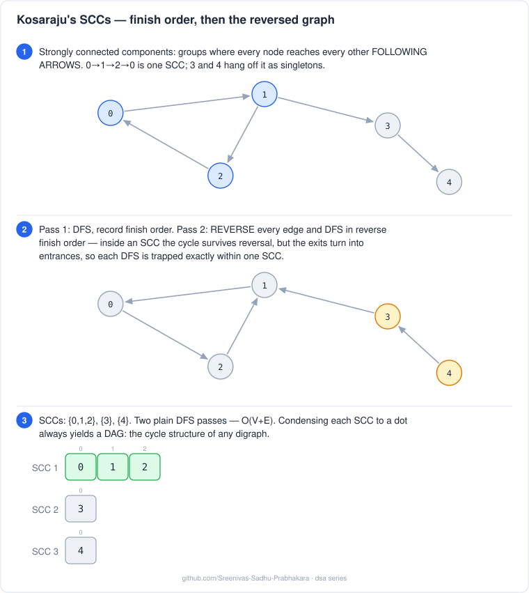

# Strongly Connected Components (Kosaraju)

> Striver SDE Sheet 164 · Day 24 Graph II — finish order on the graph, then DFS the transpose in reverse finish order; each second-pass tree is exactly one SCC. Go, stdlib only, tested.

## Problem

Partition a directed graph into its strongly connected components — maximal sets where every vertex reaches every other. SCCs are the "collapse the cycles" operation that turns any digraph into a DAG.

## Approach

Kosaraju's two DFS passes. Pass one records vertices by *finish time* on the original graph. Pass two runs DFS on the **transpose** (all edges reversed) picking start vertices in reverse finish order; whatever each DFS reaches is one SCC. Why it works, compressed: reversing edges preserves SCCs but flips the direction of the condensation DAG, and reverse finish order guarantees each pass-two DFS starts in a "source" component of the transpose — so it can't leak into a different component. Two linear passes, one graph copy. (Tarjan computes the same thing in one pass with a low-link stack; Kosaraju is the one you can re-derive under pressure.)

**Complexity:** O(V+E) time, O(V+E) space.

## Visual walkthrough

Read the picture top to bottom — each numbered frame is one moment of the algorithm
running on this repo's test example.

## Run

    go test ./...   # verify
    go run .        # demo

---

One of 191 repos solving Striver's SDE Sheet in Go — stdlib only, one problem per repo, every solution tested. Browse the set: [`dsa-*` repos](https://github.com/Sreenivas-Sadhu-Prabhakara?tab=repositories&q=dsa-&type=source).
